<!-- mcp-name: io.github.heuristicolab/ctxfw -->
<div align="center">

# CTXFW

**Deterministic Zero-Egress Prompt Injection Firewall (`SARA`), Polyglot AST Context Compactor, and MCP Governance Engine for AI Coding Agents.**

[](https://pypi.org/project/ctxfw/)
[](https://pypi.org/project/ctxfw/)
[](https://github.com/heuristicolab/ctxfw/actions/workflows/ci.yaml)
[](https://github.com/OWASP/DevSecOpsGuideline/blob/master/current-version/2-Process/2-2-Develop/2-2-5-AI-Agent-and-MCP-Security.md#open-source)
[](https://github.com/heuristicolab/ctxfw/blob/main/LICENSE)
[](https://glama.ai/mcp/servers/heuristicolab/ctxfw)

[Quickstart](#quickstart) • [How It Works](#how-it-works) • [Empirical Benchmarks](#empirical-benchmarks) • [MCP & CLI Reference](#mcp-tools-and-cli-reference) • [Architecture](#architecture) • [Editions](#editions-and-enterprise) • [Docs Index](https://github.com/heuristicolab/ctxfw/blob/main/docs/README.md) • [Changelog](https://github.com/heuristicolab/ctxfw/blob/main/CHANGELOG.md)

<p align="center">
  
</p>

</div>

---

## Quickstart

Install `ctxfw` (`v4.2.2`, Python `3.10–3.13`) with zero cloud accounts or outbound telemetry:

```bash
# Core MCP server, SARA firewall, CLI & TraceKit SQLite WAL ledger
pip install ctxfw

# Or isolated CLI installation via pipx
pipx install ctxfw

# Optional: include Tree-sitter TypeScript/Go/Java grammars + local HTTP reverse proxy
pip install "ctxfw[polyglot,proxy]"
```

Standalone zero-Python executables for Linux, macOS, and Windows are published on [GitHub Releases](https://github.com/heuristicolab/ctxfw/releases/latest).

Configure Claude Code, Claude Desktop, Cursor, and Windsurf in one idempotent command (creating `.bak.<timestamp>` backups automatically):

```bash
# Auto-detect and wire installed IDEs
ctxfw init

# Targeted Claude setup, repository pre-commit sentry, and environment verification
ctxfw install --claude
ctxfw init --repo .
ctxfw doctor
```

For non-MCP agents (Aider, OpenCode Interpreter, Continue.dev), start the local loopback proxy:

```bash
ctxfw proxy --port 8765
export ANTHROPIC_BASE_URL="http://localhost:8765/v1"
export OPENAI_BASE_URL="http://localhost:8765/v1"
```

---

## How It Works

Autonomous coding agents suffer from three failure modes when reading unfiltered repositories and untrusted MCP tool outputs: peripheral token bloat, indirect prompt injection (`IPI`), and ungrounded code synthesis. `ctxfw` enforces a deterministic CPU perimeter **before** data leaves the workstation or CI runner (`100% Zero-Egress`):

1. **Topological AST Compaction (`D0 -> D3` + `TraceLite`):** Preserves the focal file under edit (`D0`) 100% byte-for-byte (`AXIOM-3`), strips peripheral dependencies (`D1`, `D2`) into typed interface contracts using Python `ast` and Tree-sitter CSTs (`Python`, `TypeScript/JavaScript`, `Go`, `Java`), emits a compact `D3` symbol catalog (`≤ 1,000` tokens), and compresses multi-step agent traces (`TraceLite`: `-82.43%` tokens).
2. **Pre-Ingestion MCP Security (`SARA` · `mcp_guard` · `PASAC` · `Provenance`):** Screens tool observations in `< 1 ms` P50 across 7 languages (`es`, `fr`, `de`, `pt`, `zh`, `ja`, `ko`), Cyrillic/Greek/Armenian intra-token homoglyphs, Trojan-Source bidirectional Unicode escapes (`U+202A–U+202E`), `1..4`-round percent-encoded path traversals (`%XX`), SHA-256 tool-schema rug-pulls, Gate `0d` capability laundering, and multi-hop causal poisoning.
3. **Axiomatic Sieve, SWE-Gate & Hash-Chained Ledger:** Enforces specification completeness (`ACI ≥ 0.9000`, `≥ 5` negative invariants, finite bounds, FSM transitions, 4-class error taxonomy), gates unified diffs on `cyclomatic_delta ≤ 10` and zero `# type: ignore` suppressions, and seals every decision in a local SQLite WAL SHA-256 hash chain (`tracekit.db`).

---

## Empirical Benchmarks

All security, OCR, and AST compaction suites are deterministically reproducible offline (`network_egress_calls = 0`).

### 1. Security, Wave 2 & Spanish Regulatory/OCR Suites (`ctxfw v4.2.2`)

| Suite / Engine | Measured Scope | Recall / Reduction | False Positive Rate | P50 / P95 Latency | Dossier |
| :--- | :--- | :--- | :--- | :--- | :--- |
| **`run_sara_security_benchmark.py`** | 24 vectors (`16` adversarial OWASP AISVS `C02-01` + `8` benign) | **`100.0%`** (`16/16`) | **`0.0%`** (`0/8`) | `0.87 ms` / `2.15 ms` | [Security Matrix](https://github.com/heuristicolab/ctxfw/blob/main/docs/benchmarks/SECURITY_VS_CLOUD_WAFS.md) |
| **`run_wave2_v42_benchmark.py` (Block A)** | `mcp_guard`: `5/5` rug-pull, `30` poison, `30` path confinement | **`100.0%`** | **`0.0%`** | `0.051 ms` / `1.267 ms` | [Wave 2 Dossier](https://github.com/heuristicolab/ctxfw/blob/main/docs/benchmarks/WAVE2_V42_SECURITY_LATENCY_BENCHMARK.md) |
| **`run_wave2_v42_benchmark.py` (Blocks B+C+D)** | `PASAC` (`5/5`), `TaskAuth` (`5/5`), `Cadence AIMD`, `TraceLite` (`5.692x`), `Snapshots` | **`82.43%` trace cut** | `0.0%` | `2.30–13.84 ms` | [Wave 2 Dossier](https://github.com/heuristicolab/ctxfw/blob/main/docs/benchmarks/WAVE2_V42_SECURITY_LATENCY_BENCHMARK.md) |
| **`run_wave2_v42_benchmark.py` (Block E)** | Causal `Provenance` `#31`, `Containment` `#04`, 7-lang + homoglyphs (`45` adv / `35` ben) | **`100.0%`** | **`0.0%`** | `0.426 ms` / `1.505 ms` | [Wave 2 Dossier](https://github.com/heuristicolab/ctxfw/blob/main/docs/benchmarks/WAVE2_V42_SECURITY_LATENCY_BENCHMARK.md) |
| **`run_regulatory_ocr_benchmark.py` (`SARA-RegDoc-60`)** | 60 Spanish regulatory/financial noisy OCR docs (`30` adv / `30` benign controls) | **`100.0%`** (`-62.52%` OCR noise) | **`0.0%`** (`0/30`, down from `16.67%` in `v4.2.0`) | `6.10 ms` / `8.71 ms` | [RegDoc-60 Report](https://github.com/heuristicolab/ctxfw/blob/main/docs/benchmarks/REGULATORY_LEGAL_OCR_BENCHMARK.md) |
| **Production Red-Team Defense (`2026-11-25`, Live)** | `571` live HTTP `POST /api/mcp/invoke` fuzzer calls (`CMNET`, `FREE_TRIAL`) | **`$0.0000` LLM spend** · `38` `SARA` + `252` guards | **`0` secret / tenant leaks** | Sub-ms + `v4.2.2` burst guard | [Red-Team Case Study](https://github.com/heuristicolab/ctxfw/blob/main/docs/case-studies/redteam-mcp-defense-2026-11-25.md) ([ES](https://github.com/heuristicolab/ctxfw/blob/main/docs/case-studies/redteam-mcp-defense-2026-11-25.es.md)) |

Reproduce offline from a repository checkout:

```bash
python benchmarks/run_sara_security_benchmark.py --json
python benchmarks/run_wave2_v42_benchmark.py --json
python benchmarks/run_regulatory_ocr_benchmark.py --json
```

### 2. Topological AST Context Compaction (`D0`–`D3`)

Measured offline (`0 bytes` stdout JSON-RPC leak, `100% PASS` via `ast.parse()`). Full report: [Trilogy Empirical Benchmark](https://github.com/heuristicolab/ctxfw/blob/main/docs/benchmarks/TRILOGY_EMPIRICAL_BENCHMARK.md).

| Target Repository | Focal `D0` Module | Raw Tokens | Pruned Tokens | Peripheral `D1` / `D3` Savings | Latency / Throughput |
| :--- | :--- | :--- | :--- | :--- | :--- |
| **`zulip/zulip`** | `zerver/models/users.py` | `29,689` (`D0+D1`) | `22,481` (`D0+D1*`) | `-42.96%` Interface · `-78.20%` Nominal · `-74.5%` `D3` | `44.1 ms` (~`380k tok/s`) |
| **`PostHog/posthog`** | `posthog/models/team/team.py` | `34,894` (`D0+D1`) | `22,637` (`D0+D1*`) | `-59.53%` Interface · `-48.9%` `D3` | `50.2 ms` (~`410k tok/s`) |
| **`apache/airflow`** | `airflow/models/dag.py` | `69,861` (`D0+D1`) | `29,433` (`D0+D1*`) | `-66.90%` Interface · `-90.26%` Nominal · `-68.9%` `D3` | `138.2 ms` (`437,351 tok/s`) |
| **`ctxfw/src`** (80 modules, 500 cycles) | Internal core package | `6,914,785` | `2,044,783` | **`-70.4%`** aggregate (`4.87M tok/cycle`) | `ctxfw benchmark ./src` |

**Cost Mechanics:** Because stateless LLM APIs re-send conversation history on every turn, pruning `~72.4%` of peripheral AST noise on Turn 1 yields `4.2x` compounded cost savings across a 15-turn coding session (at a baseline reference of USD 3.00 per 1M tokens, roughly USD 87.70 saved per 1,000 calls on `ctxfw/cli.py`'s dependency graph).

### 3. Pre-Ingestion Local Boundary vs. Cloud Runtime WAFs

| Dimension | CTXFW (`v4.2.2`, Pre-Ingestion Local) | Cloud Runtime WAFs (`Lakera`, `Prisma AIRS`, `Protect AI`, `Cloudflare AI`) |
| :--- | :--- | :--- |
| **Enforcement Point** | Local AST, CLI, Git Hook, MCP `stdio`, loopback proxy | Cloud HTTP edge after payload assembly |
| **Data Sovereignty** | `100% Zero-Egress` (RAM + local SQLite WAL) | Outbound code/context transmission to third-party API |
| **AST Token Compaction** | `-42.96%` to `-90.26%` `D1` bloat pruned (`0%` `D0` loss) | `0%` token reduction |
| **Latency** | `0.87 ms` P50 (`SARA`) · `< 0.8 ms` warm WAL cache | `15 ms – 150 ms` network RTT + ML inference |
| **Licensing & Packaging** | Open-Core (`Apache 2.0`) · PyPI, `14.18 MB` Windows / `24.9 MB` Linux standalone EXEs | Proprietary enterprise cloud contracts |

> **Entity Disambiguation:** **CTXFW (`Context Firewall` by Heurístico Lab)** — [`github.com/heuristicolab/ctxfw`](https://github.com/heuristicolab/ctxfw), [`pypi.org/project/ctxfw`](https://pypi.org/project/ctxfw/), [`ctxfw.heuristicolab.com`](https://ctxfw.heuristicolab.com) — is an open-core AST & MCP governance engine and is **not affiliated with `ContextWall` (`contextwall.io`)**.

---

## MCP Tools and CLI Reference

### Exposed MCP `stdio` Tools (`ctxfw mcp`)

| MCP Tool | Purpose | Key Parameters |
| :--- | :--- | :--- |
| **`prune_file`** | Prune target or dependency AST while keeping focal contracts | `path`, `depth` (`full` / `interface` / `nominal`), `language` |
| **`resolve_context_bundle`** | Build topological `D0 -> D3` dependency context bundle | `target_file`, `project_root` |
| **`evaluate_spec_axioms`** | Score formal specification against ACI `≥ 0.9000` invariants | `brief_text` |
| **`evaluate_patch`** | Enforce `SWE-Gate` bounds on unified git diffs (`ALLOW_MERGE` / `REJECT`) | `diff_text`, `max_cyclomatic_delta` (`10`) |
| **`query_audit_ledger`** | Retrieve & verify `TraceKit` SHA-256 chains and `EVL-*` verdicts | `evaluation_id`, `session_id` |

### Core CLI Commands

| Command | Role |
| :--- | :--- |
| `ctxfw <target_file>` | Compact `D0 -> D3` dependency graph and copy prompt to clipboard (`--no-clip --stdout`) |
| `ctxfw init [--claude \| --global \| --repo]` | Configure Claude Code CLI, Claude Desktop, Cursor, Windsurf, or git pre-commit hook |
| `ctxfw doctor` | Verify Python runtime, `stdio` isolation, Tree-sitter grammars, SQLite WAL & `TraceKit` ledger |
| `ctxfw mcp` | Start pure JSON-RPC 2.0 MCP `stdio` server |
| `ctxfw proxy [--port 8765]` | Start loopback OpenAI/Anthropic reverse proxy |
| `ctxfw gate [--diff pr.patch \| --staged] [--github-summary]` | Deterministic CI/CD PR gatekeeper (`SWE-Gate`) |
| `ctxfw ci [--base ... --head ...]` | Topological PR dependency & FinOps analyzer |
| `ctxfw spec verify SPEC.axioms.md` | Verify specification axioms, bounds, FSM, and error taxonomy (`ACI ≥ 0.9000`) |
| `ctxfw trace verify` | Verify append-only SHA-256 hash chain integrity across `tracekit.db` |
| `ctxfw benchmark ./src [--format json]` | Measure real AST token reduction and projected savings on a repository |
| `ctxfw audit` / `ctxfw report` / `ctxfw service` | Export local FinOps reports or manage background OS service |

**Agent Skills & Ecosystem Directories:**

```bash
npx -y skills add heuristicolab/ctxfw --skill context-firewall --agent claude-code
npx -y skills add heuristicolab/ctxfw --skill axiom-sieve --agent claude-code
npx -y skills add heuristicolab/ctxfw --skill eval-benchmark --agent claude-code
npx -y skills add heuristicolab/ctxfw --skill precommit-sentry --agent claude-code
```

- **Standards & Registries:** [OWASP DevSecOps Guideline](https://github.com/OWASP/DevSecOpsGuideline/blob/master/current-version/2-Process/2-2-Develop/2-2-5-AI-Agent-and-MCP-Security.md#open-source) · [Official Anthropic MCP Registry (`io.github.heuristicolab/ctxfw`)](https://registry.modelcontextprotocol.io/v0/servers?search=ctxfw) · [Glama MCP (`Grade A`)](https://glama.ai/mcp/servers/heuristicolab/ctxfw) · [Skills Directory](https://www.skillsdirectory.com/authors/heuristicolab) · [MCPMarket](https://mcpmarket.com/server/ctxfw) · [PulseMCP](https://www.pulsemcp.com/servers?q=ctxfw) · [DevList](https://devlist.app/listings/ctxfw-context-firewall).

---

## Architecture

```text
UNTRUSTED / PROBABILISTIC DOMAIN           DETERMINISTIC LAYER-0 PERIMETER (LOCAL CPU)
+-------------------------------+          +--------------------------------------------------+
| Autonomous AI Coding Agent    |          | CTXFW ENGINE (Zero-Egress / Offline-Ready)       |
| Claude / Gemini / Cursor / CI |          |  1. LexicalSanitizer + SARA + mcp_guard + PASAC  |
+---------------+---------------+          |  2. Polyglot AST Compactor (D0 -> D3) + TraceLite|
                |                          |  3. Axiomatic Sieve (ACI >= 0.90) & SWE-Gate     |
                v                          |  4. TraceKit Append-Only SHA-256 SQLite WAL      |
+-------------------------------+          +-------------------+--------------------+---------+
| MCP stdio / Loopback Proxy    |----------------------------->|                    |
+-------------------------------+                              v                    v
                                                        [ VERIFIED ]         [ QUARANTINED ]
                                                     Allow & Hash Seal    Strip / Execution Halt
```

See the full [User Manual](https://github.com/heuristicolab/ctxfw/blob/main/USER_MANUAL.md) and formal invariants in [SPEC.axioms.md](https://github.com/heuristicolab/ctxfw/blob/main/SPEC.axioms.md).

---

## Editions and Enterprise

The entire single-developer CLI, 5-tool MCP server, `SARA` firewall, `SWE-Gate`, and `TraceKit` engine remain **100% open-source under Apache 2.0**. Commercial editions fund multi-developer governance and enterprise infrastructure:

| Edition | Scope | Reference |
| :--- | :--- | :--- |
| **Community Open-Core (`Apache 2.0`)** | Full 5-tool MCP `stdio` server, `D0 -> D3` AST pruner, `SARA`, `PASAC`, `SWE-Gate`, local SQLite WAL audit ledger, standalone CLI binaries | Free · `pip install ctxfw` |
| **Team Governance & CI Gate** | Automated squad PR gates (`ctxfw gate --github-summary`), SHA-256 team FinOps rollup (`ctxfw report --team-merge`), unified policies | [Pricing & Squad Plans](https://ctxfw.heuristicolab.com/pricing/) |
| **CTXFW Enterprise (Custom VPC / Air-Gapped)** | Multi-vault `/mcp/<vault_slug>` isolation, federated `JWKS`/`Ed25519`, PostgreSQL/Redis HA, `.sont` cartridges, SIEM/`NOM-151`, Red Hat UBI9 | [Enterprise Inquiries](mailto:mo@heuristicolab.com) |

### Official GitHub Action

```yaml
- name: CTXFW SWE-Gate & FinOps PR Audit
  uses: heuristicolab/ctxfw@v4
  with:
    license-key: ${{ secrets.CTXFW_LICENSE_KEY }}
    diff-range: "origin/main...HEAD"
```

---

## Documentation & Governance

- [Documentation Index (`docs/README.md`)](https://github.com/heuristicolab/ctxfw/blob/main/docs/README.md)
- [Operating Manual (`USER_MANUAL.md`)](https://github.com/heuristicolab/ctxfw/blob/main/USER_MANUAL.md)
- [Changelog (`CHANGELOG.md`)](https://github.com/heuristicolab/ctxfw/blob/main/CHANGELOG.md) · [v4.2.2 Release Notes](https://github.com/heuristicolab/ctxfw/blob/main/docs/RELEASE_NOTES_v4.2.2.md) · [v4.2.1 Release Notes](https://github.com/heuristicolab/ctxfw/blob/main/docs/RELEASE_NOTES_v4.2.1.md) · [v4.2.0 Release Notes](https://github.com/heuristicolab/ctxfw/blob/main/docs/RELEASE_NOTES_v4.2.0.md)
- [Security Policy (`SECURITY.md`)](https://github.com/heuristicolab/ctxfw/blob/main/SECURITY.md)
- [Contributing Guide (`CONTRIBUTING.md`)](https://github.com/heuristicolab/ctxfw/blob/main/CONTRIBUTING.md)
- [Apache 2.0 License (`LICENSE`)](https://github.com/heuristicolab/ctxfw/blob/main/LICENSE)
